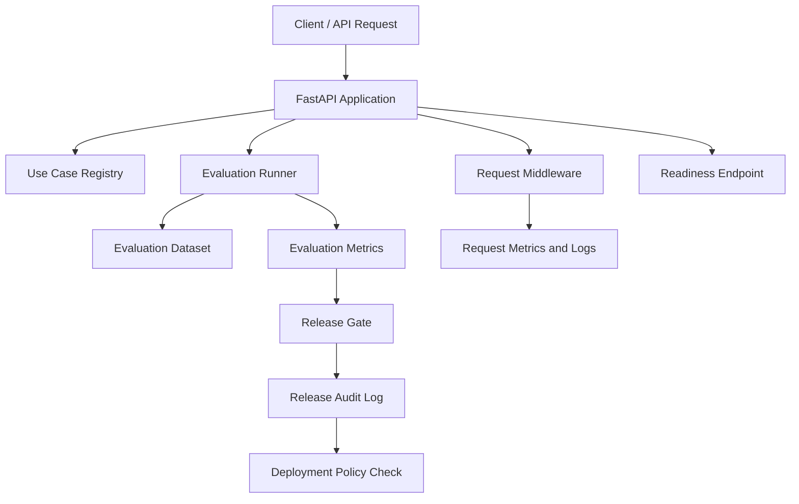

# Enterprise AI Deployment & Evaluation Platform

A Python and FastAPI platform demonstrating evaluation, release governance, deployment policy enforcement, audit logging, and observability for AI applications.

The project focuses on the engineering systems needed to evaluate AI application candidates, make evidence-based release decisions, and enforce deployment policies before an application is released.

## Key Features

- Dataset-based AI application evaluation
- Task success, category accuracy, and priority accuracy metrics
- Latency and cost tracking
- Candidate comparison reports
- Configurable release gates for quality, latency, cost, and safety
- Human approval requirements for deployment
- Auditable release decisions
- Health and readiness endpoints
- Request IDs, structured logging, and request metrics
- Automated tests and continuous integration with GitHub Actions

## Architecture



This is a high-level architecture diagram, not an exact request-by-request execution sequence.

## Evaluation and Release Governance

The platform provides a reproducible workflow for assessing application candidates before deployment.

### Evaluation Capabilities

- **Dataset-based evaluation:** Runs predictions against a customer feedback dataset.
- **Quality metrics:** Measures task success, category accuracy, and priority accuracy.
- **Operational metrics:** Tracks latency and estimated cost.
- **Candidate comparison:** Generates a comparison of candidate evaluation metrics.
- **Release gates:** Checks configured quality, latency, cost, and safety thresholds.
- **Human oversight:** Supports required human approval before deployment.
- **Audit history:** Records release decisions for later review.
- **Observability:** Exposes health, readiness, request metrics, and request IDs.

### Generate Evaluation Reports

Run these commands from the repository root with the virtual environment activated.

Generate the baseline evaluation report:

```powershell
python -c "from app.evaluation.report_generator import generate_report; print(generate_report())"
```

Generate the candidate comparison report:

```powershell
python -c "from app.evaluation.candidate_comparison import generate_baseline_comparison; print(generate_baseline_comparison())"
```

The reports are written to:

- `reports/baseline_evaluation.json`
- `reports/candidate_comparison.json`

The generated reports provide a record of evaluation metrics and candidate comparisons.
### Generate an Error Analysis Report

Run the following command to inspect incorrect baseline predictions and recurring classification errors:

```powershell
python -m app.evaluation.error_analysis
```

The report is written to `reports/error_analysis.json` and includes:

- Dataset size and overall error rate.
- Incorrect cases with expected and predicted categories.
- Incorrect cases with expected and predicted priorities.
- Recurring category and priority error patterns.

This report evaluates the deterministic keyword baseline against the supplied synthetic dataset. Its results should not be interpreted as production model performance.
## Release Governance

The release gate evaluates candidates against configured thresholds for task success, latency, cost, and safety.

Deployment policy enforcement checks whether a candidate has an approved release record and whether required human approval has been granted.

Release decisions are recorded in an audit log to support later inspection and review.

The platform separates evaluation, release approval, and deployment permission so that passing an evaluation does not automatically authorize deployment.

## Observability and Readiness

The application exposes operational endpoints and request-level signals to support local development and troubleshooting.

- **Health endpoint:** Checks whether the application is responding.
- **Readiness endpoint:** Checks required local resources, including the evaluation dataset and audit-log directory.
- **Request IDs:** Associates requests with identifiers to support log correlation.
- **Request metrics:** Tracks request counts, server errors, and request latency.
- **Logging:** Records request activity for troubleshooting and operational visibility.

The current metrics implementation is in memory and is intended for demonstration rather than distributed production monitoring.

## Continuous Integration

GitHub Actions runs the automated test suite on pushes and pull requests targeting `main` or `master`.

The workflow:

1. Checks out the repository.
2. Sets up Python 3.12.
3. Installs dependencies from `requirements.txt`.
4. Runs the test suite using pytest.

A failed test run causes the workflow to fail, providing an early warning before changes are merged.

## Getting Started

### Prerequisites

- Python 3.12 or a compatible Python version
- Git
- A terminal or IDE such as Visual Studio Code

The GitHub Actions workflow uses Python 3.12. Local development may use a different Python version, subject to dependency compatibility.

### Install Dependencies

Clone the repository and navigate to the project directory. Then create and activate a virtual environment.

On Windows PowerShell:

```powershell
python -m venv .venv
.\.venv\Scripts\Activate.ps1
python -m pip install -r requirements.txt
```

### Run the Application

From the repository root:

```powershell
python -m uvicorn app.main:app --reload
```

Open the interactive API documentation at:

`http://127.0.0.1:8000/docs`

The health and readiness endpoints can be tested at:

- `http://127.0.0.1:8000/health`
- `http://127.0.0.1:8000/ready`

The metrics endpoint is available at:

- `http://127.0.0.1:8000/metrics`

### Run Tests

From the repository root, with the virtual environment activated:

```powershell
python -m pytest -q
```

The test suite covers API behavior, evaluation, release gates, deployment policies, audit logging, readiness, and metrics.

## Current Limitations

- Use-case registrations are stored in memory and reset when the application restarts.
- Release audit history uses a local JSONL file rather than a managed database.
- Human approval is not connected to authenticated reviewer identities.
- Evaluation uses a small synthetic dataset and a deterministic keyword-based baseline, not a live LLM.
- Candidate comparison latency and cost values are simulated rather than measured from actual model calls.
- Safety has not been independently validated.
- Deployment policy checks permission; it does not deploy a model or application.
- Request metrics are stored in memory and are not shared across multiple application workers.
- Production authentication, authorization, secrets management, and distributed observability are not fully implemented.

These limitations are documented explicitly so that demonstration results are not mistaken for production-level AI performance or deployment readiness.

## Technology Stack

- **Language:** Python
- **API framework:** FastAPI
- **Data validation:** Pydantic
- **Testing:** Pytest
- **CI/CD checks:** GitHub Actions
- **Evaluation data:** JSON
- **Audit storage:** JSONL

## Project Goal

Demonstrate practical engineering patterns for evaluating AI applications, enforcing release policies, maintaining auditable decisions, and exposing operational signals before deployment.

The project is a portfolio demonstration of AI application evaluation and governance workflows. It is not yet a production deployment platform, and its evaluation results do not establish the performance or safety of a live AI model.