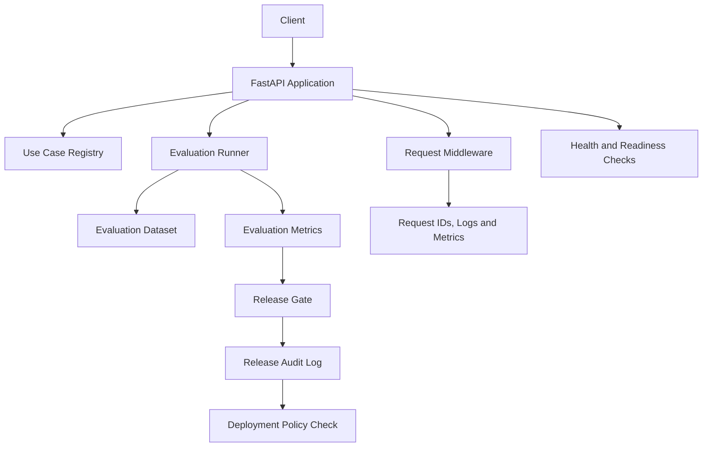

# Enterprise AI Deployment & Evaluation Platform

A Python and FastAPI portfolio project demonstrating evaluation workflows, candidate comparison, release governance, deployment policy enforcement, audit logging, and observability for AI applications.

The platform focuses on an important enterprise AI engineering problem: **how to evaluate a candidate, make an evidence-based release decision, and verify deployment permission before release.**

## Key Features

- Dataset-based evaluation of AI application candidates
- Task success, category accuracy, and priority accuracy metrics
- Latency and estimated-cost tracking
- Candidate comparison and error analysis reports
- Configurable release gates for quality, latency, cost, and safety
- Fail-closed handling of missing safety evidence
- Deployment policy checks and human approval requirements
- JSONL audit logging of release decisions
- Health, readiness, and evaluation-monitoring endpoints
- Request IDs, structured logging, and request metrics
- Automated tests and GitHub Actions continuous integration

## Architecture



This diagram illustrates the main components and their relationships; it is not an exact execution trace for every API request.

## Evaluation Workflow

The evaluation pipeline runs predictions against a supplied synthetic customer-feedback dataset and calculates:

- Task success rate
- Category and priority accuracy
- Per-category accuracy and failed case IDs
- Average latency and estimated cost
- Average safety score when evidence is available

Candidate comparison and error analysis help identify metric differences and recurring classification errors.

### Generate reports

Run these commands from the repository root with the virtual environment activated:

```powershell
python -c "from app.evaluation.report_generator import generate_report; print(generate_report())"
python -c "from app.evaluation.candidate_comparison import generate_baseline_comparison; print(generate_baseline_comparison())"
python -m app.evaluation.error_analysis
```

Expected report paths, as configured by the application:

- `reports/baseline_evaluation.json`
- `reports/candidate_comparison.json`
- `reports/error_analysis.json`

These reports describe the supplied dataset and deterministic baseline. They do not establish the performance of a live model on real customer workloads.

### Interpreting evaluation results

- **Task success rate and accuracy:** Measure how well the candidate performs on the supplied evaluation dataset.
- **Failed case IDs:** Identify individual examples that need investigation; review the error analysis report to find recurring failure patterns.
- **Candidate comparison:** Compare metrics and errors across candidates using the same dataset to identify regressions and trade-offs.
- **Release decision:** A candidate is approved only when all configured release gates pass, including quality, latency, cost, and safety evidence. Missing or invalid safety evidence fails closed and prevents approval.
- **Human approval:** If deployment policy requires human approval, an approved evaluation alone is insufficient. The required approval must also be satisfied before deployment is authorized.

Evaluation results are evidence for a release decision, not a guarantee of production performance. Review failed cases and relevant risks before approving a candidate.

## Release Governance

The release gate checks candidate metrics against configured thresholds for:

- Task success
- Latency
- Cost per task
- Safety evidence

The deployment policy separately checks release approval and any required human approval. Passing evaluation does not automatically authorize deployment.

Release decisions are recorded in a local JSONL audit file for subsequent inspection.

## Observability and API

The application exposes operational endpoints for health, readiness, request metrics, and evaluation monitoring.

Start the application:

```powershell
python -m uvicorn app.main:app --reload
```

Once it is running, explore the interactive API documentation:

- API documentation: `http://127.0.0.1:8000/docs`
- Health: `http://127.0.0.1:8000/health`
- Readiness: `http://127.0.0.1:8000/ready`
- Request metrics: `http://127.0.0.1:8000/metrics`

Evaluation monitoring endpoints include evaluation summary and evaluation health. Their exact paths and response schemas are defined by the API implementation.

Request IDs support log correlation. Structured logs provide request-level operational visibility, while the current metrics implementation is intended for local demonstration rather than distributed production monitoring.

## Frontend Dashboard

The project includes a React and TypeScript dashboard built with Vite. It provides a visual interface for exploring use cases, evaluations, release governance, audit history, and observability.

### Start the frontend

Prerequisites: Node.js and npm.

Open a **second terminal** from the repository root, keeping the FastAPI backend running in the first terminal.

```powershell
cd frontend
npm install
npm run dev
```

Open the local URL printed by Vite in your terminal (typically `http://localhost:5173`).

The Vite development server proxies API requests to the FastAPI backend at `http://127.0.0.1:8000`.

### Validate the frontend

Run these commands from the `frontend` directory:

```powershell
npm run lint
npm run build
```

The build runs TypeScript checks and generates the production frontend assets in `frontend/dist/`.

## Getting Started

### Prerequisites

- Python compatible with the pinned dependencies
- Git
- A terminal or IDE such as Visual Studio Code

The GitHub Actions workflow is configured for Python 3.12. Local development has also been tested in Python 3.14.7.

### Install

Clone the repository and navigate to its root directory. Then create and activate a virtual environment.

Windows PowerShell:

```powershell
python -m venv .venv
.\.venv\Scripts\Activate.ps1
python -m pip install -r requirements.txt
```

### Run tests

```powershell
python -m pytest -q
```

The latest verified local run completed with **103 passed tests** and one Starlette deprecation warning. Test results may change as the project evolves.

## Technology Stack

- **Language:** Python
- **API:** FastAPI
- **Validation and settings:** Pydantic and Pydantic Settings
- **Testing:** Pytest
- **HTTP test client:** HTTPX
- **ASGI server:** Uvicorn
- **CI:** GitHub Actions
- **Evaluation data:** JSON
- **Audit storage:** JSONL

## Current Limitations

This project is an offline portfolio prototype, not a production deployment platform.

- The evaluation dataset is small and synthetic.
- The baseline is deterministic and keyword-based; no live LLM provider is integrated.
- Candidate comparison latency and cost figures are simulated rather than measured from real model calls.
- Use-case registrations and request metrics are held in memory.
- Audit history is stored locally rather than in a managed database.
- Human approval is not tied to authenticated reviewer identities.
- Safety scores are not independently validated safety guarantees.
- Deployment policy checks permission; it does not deploy an application or model.
- Production authentication, authorization, enterprise identity, secrets management, distributed tracing, and external monitoring integrations are not fully implemented.

The application should not be exposed to untrusted users or treated as production-ready without additional security and operational work.

## Recommended Next Steps

1. Evaluate against representative, approved real-world datasets.
2. Add persistent storage for evaluation runs, release decisions, and audit history.
3. Integrate a model provider and measure actual latency, token usage, and cost.
4. Implement authentication, authorization, secret management, and data-retention controls.
5. Validate reliability and security in a controlled deployment environment.

## Project Goal

Demonstrate practical engineering patterns for AI application evaluation, release governance, auditable decisions, and operational visibility before deployment—without requiring a paid LLM API key or Docker for local development.