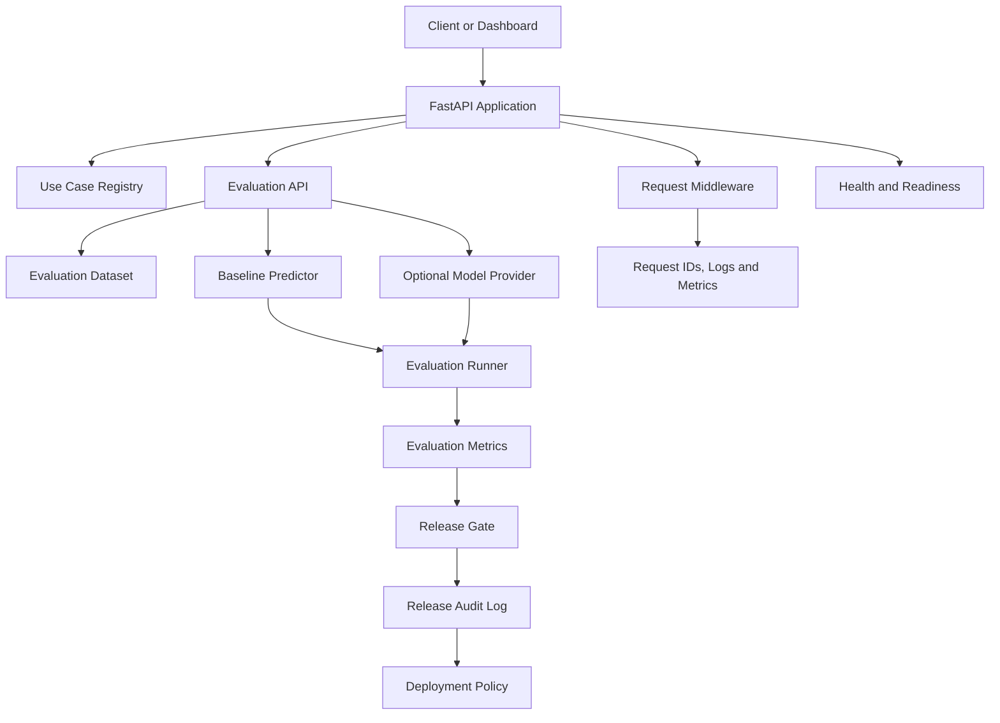
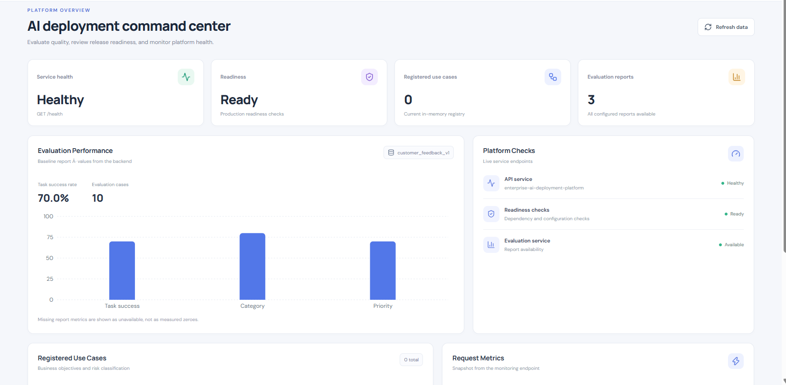
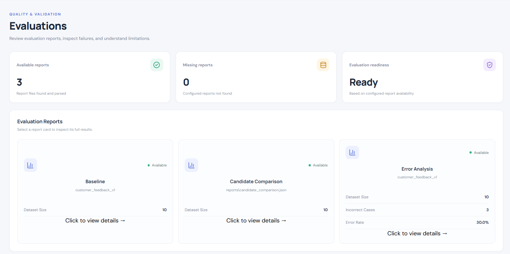
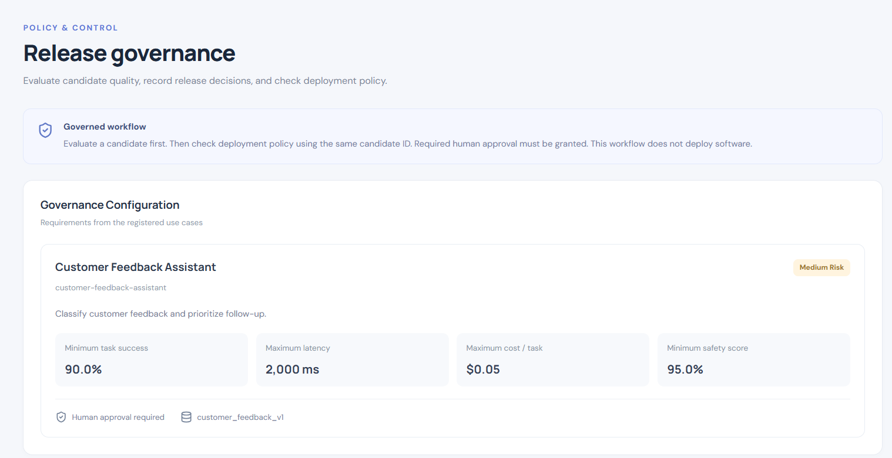

# Enterprise AI Reliability & Deployment Platform

An enterprise-focused AI evaluation and release-governance platform built with Python and FastAPI, with a React and TypeScript dashboard. It helps teams evaluate AI application candidates, compare model outputs, measure performance, identify risks, and make auditable release decisions before deployment.

The platform demonstrates a core Applied AI Engineering workflow: **evaluate → analyze → gate → approve → audit**.

## Key Features

- Dataset-based evaluation of AI application candidates
- Task success, category accuracy, and priority accuracy metrics
- Per-category accuracy and failed-case analysis
- Baseline and candidate comparison using a shared evaluation dataset
- Configurable release gates for quality, latency, cost, and safety evidence
- Optional OpenAI-compatible model-provider integration
- Real request-latency measurement and token-based cost estimation for provider calls
- Fail-closed handling of missing safety evidence
- Release decisions and human-approval policy checks
- JSONL audit logging of release decisions
- Health, readiness, evaluation-monitoring, and request-metrics endpoints
- Request IDs and structured logging
- React and TypeScript frontend dashboard
- Automated tests and GitHub Actions continuous integration

## Architecture



The diagram represents the main logical components. It is not an exact execution trace for every API request.

## Evaluation Workflow

The evaluation pipeline runs candidate predictions against a supplied synthetic customer-feedback dataset and calculates:

- Task success rate
- Category and priority accuracy
- Per-category accuracy and failed case IDs
- Average request latency
- Estimated cost per task
- Average safety score when evidence is available

Candidate comparison and error analysis help identify metric differences, regressions, and recurring classification errors.

### Generate reports

Run these commands from the repository root with the virtual environment activated:

```powershell
python -c "from app.evaluation.report_generator import generate_report; print(generate_report())"
python -c "from app.evaluation.candidate_comparison import generate_baseline_comparison; print(generate_baseline_comparison())"
python -m app.evaluation.error_analysis
```

Expected report paths:

- `reports/baseline_evaluation.json`
- `reports/candidate_comparison.json`
- `reports/error_analysis.json`

These reports describe the configured dataset and baseline. They do not establish performance on real customer workloads.

### Model-provider evaluation

The platform includes an optional OpenAI-compatible chat-completions adapter. The existing deterministic baseline remains available without a paid model API.

The provider endpoint evaluates the registered dataset for a use case, calculates metrics, applies the existing release gates, and records the resulting decision in the audit log.

**Endpoint**

```http
POST /evaluations/{use_case_id}/provider-release-decision?candidate_id={candidate_id}
```

**Required environment variables**

Configure these variables in your local environment before calling the endpoint:

| Variable | Purpose |
|---|---|
| `AI_PROVIDER_BASE_URL` | Provider API base URL, including any required version path |
| `AI_PROVIDER_API_KEY` | Provider authentication key |
| `AI_PROVIDER_MODEL` | Model identifier |
| `AI_PROVIDER_INPUT_USD_PER_MILLION` | Configured input-token price per million tokens |
| `AI_PROVIDER_OUTPUT_USD_PER_MILLION` | Configured output-token price per million tokens |

The adapter measures elapsed request latency and estimates cost using the token counts returned by the provider and the configured token prices. The estimate depends on correct pricing configuration and provider-reported usage.

Provider calls may incur charges. Do not commit API keys to Git or place them in the README.

**Safety limitation:** The provider adapter does not yet include a validated safety evaluator. It returns no safety score. Missing safety evidence must not be interpreted as a pass; the release gate must continue to enforce its configured fail-closed policy.

### Interpreting evaluation results

- **Task success and accuracy:** Measure candidate performance on the supplied dataset.
- **Failed case IDs:** Identify examples requiring investigation.
- **Candidate comparison:** Examine metric changes and trade-offs across candidates evaluated on the same dataset.
- **Latency and cost:** Assess performance and estimated operating cost against configured thresholds.
- **Release decision:** A candidate is approved only when all required release gates pass.
- **Human approval:** If deployment policy requires human approval, evaluation approval alone is insufficient.

Evaluation results provide evidence for release decisions, not guarantees of production performance.

## Release Governance

The release gate checks candidate metrics against configured thresholds for:

- Task success
- Latency
- Cost per task
- Safety evidence

The deployment policy separately checks release approval and any required human approval. Passing evaluation does not automatically authorize deployment.

Release decisions are recorded in a local JSONL audit file for subsequent inspection. The current implementation is intended for local demonstration; it does not provide managed audit storage or authenticated reviewer identity.

## Observability and API

The application exposes operational endpoints for health, readiness, request metrics, and evaluation monitoring.

### Start the backend

From the repository root:

```powershell
python -m uvicorn app.main:app --reload
```

Explore the interactive API documentation:

- API documentation: `http://127.0.0.1:8000/docs`
- Health: `http://127.0.0.1:8000/health`
- Readiness: `http://127.0.0.1:8000/ready`
- Request metrics: `http://127.0.0.1:8000/metrics`

Evaluation summary and evaluation health endpoints are also available. Consult the API documentation for their exact paths and response schemas.

Request IDs support log correlation, and structured logs provide request-level visibility. Current metrics are intended for local demonstration rather than distributed production monitoring.

## Frontend Dashboard

The project includes a React and TypeScript dashboard built with Vite. It provides a visual interface for exploring use cases, evaluations, release governance, audit history, and observability.

### Dashboard Screenshots

#### Overview Dashboard
Platform health, readiness checks, registered use cases, and evaluation performance.



#### Evaluation Dashboard
Evaluation reports, dataset coverage, and error-analysis results.



#### Release Governance
Quality thresholds, latency and cost limits, safety requirements, and human-approval policy.



### Start the frontend

Prerequisites: Node.js and npm.

Keep the FastAPI backend running in the first terminal. Open a second PowerShell terminal from the repository root:

```powershell
cd frontend
npm install
npm run dev
```

Open the local URL printed by Vite, typically `http://localhost:5173`.

The Vite development server proxies API requests to the FastAPI backend at `http://127.0.0.1:8000`.

### Validate the frontend

Run these commands from the `frontend` directory:

```powershell
npm run lint
npm run build
```

The build runs TypeScript checks and generates production frontend assets in `frontend/dist/`.

## Getting Started

### Prerequisites

- Python compatible with the pinned dependencies
- Git
- Node.js and npm for the frontend
- A terminal or IDE such as Visual Studio Code

The GitHub Actions workflow is configured for Python 3.12. Local development has also been tested with Python 3.14.7.

### Install the backend

Clone the repository and navigate to its root directory. Create and activate a virtual environment:

```powershell
python -m venv .venv
.\.venv\Scripts\Activate.ps1
python -m pip install -r requirements.txt
```

No model-provider credentials are required to run the deterministic baseline, execute the existing tests, or generate baseline reports.

### Run tests

From the repository root:

```powershell
python -m pytest -q
```

The latest verified suite completed with **111 passed tests and one Starlette deprecation warning**. Results may change as the project evolves.

The provider API tests use mocked predictions, so they do not require paid model calls.

## Technology Stack

- **Language:** Python
- **API:** FastAPI
- **Validation and configuration:** Pydantic and Pydantic Settings
- **Evaluation:** Python evaluation pipeline and JSON datasets
- **Optional model integration:** OpenAI-compatible chat-completions API
- **HTTP client:** HTTPX
- **ASGI server:** Uvicorn
- **Frontend:** React, TypeScript, Vite
- **Testing:** Pytest
- **Audit storage:** JSONL
- **CI:** GitHub Actions

## Current Limitations

This project is an evolving portfolio prototype, not a production deployment platform.

- The evaluation dataset is small and synthetic.
- The deterministic baseline is keyword-based.
- The optional provider adapter requires compatible provider configuration and may incur API charges.
- The provider adapter does not yet implement a validated safety evaluator.
- Cost estimates depend on configured prices and provider-reported token usage.
- Use-case registrations and request metrics are held in memory.
- Audit history is stored locally rather than in a managed database.
- Human approval is not tied to authenticated reviewer identities.
- Safety evidence and scores are not guarantees of safety.
- Deployment policy checks permission; it does not deploy an application or model.
- Production authentication, authorization, secrets management, data-retention controls, distributed tracing, and external monitoring integrations are not fully implemented.

Do not expose this prototype to untrusted users or treat it as production-ready without additional security and operational work.

## Recommended Next Steps

1. Evaluate against representative, approved real-world datasets.
2. Add persistent storage for evaluation runs, release decisions, and audit history.
3. Add a validated safety-evaluation pipeline.
4. Extend provider support with robust retry policies, timeouts, and provider-specific usage handling.
5. Implement authentication, authorization, secret management, and data-retention controls.
6. Validate reliability and security in a controlled deployment environment.

## Project Goal

Demonstrate practical Applied AI Engineering patterns for evaluating AI applications, measuring reliability and operating costs, enforcing release gates, recording auditable decisions, and checking deployment permission before release—while retaining a local baseline that can run without a paid model API key or Docker.
